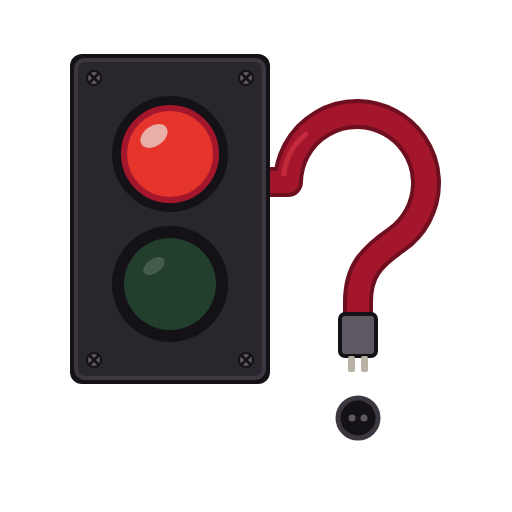

<p align="center"></p>

# askwire

**Your MCP server asks "are you sure?". In `claude -p` the answer comes back in 3 ms, in `codex exec` in 2 ms. Nobody read the question.**

askwire runs the AI clients installed on your machine (Claude Code, Codex, opencode, Gemini CLI) against a probe MCP server and shows what each one really answers to `elicitation/create`: who saw the question, what came back (`accept` / `decline` / `cancel` / error / nothing) and how fast. No account, no API key, no tokens: the model is a local scripted stand-in, and your own client configs are never read or changed.

[Landing page](https://blackman99.github.io/askwire/) · [Docs](https://blackman99.github.io/askwire/docs/) · [Releases](https://github.com/Blackman99/askwire/releases) · Blog: [Decline vs cancel, and who is actually answering](https://blackman99.github.io/askwire/blog/decline-vs-cancel/) ([中文](https://blackman99.github.io/askwire/blog/zh/decline-vs-cancel/))

<p align="center"></p>

## Why

MCP elicitation lets a server stop mid-tool-call and ask the user for input: confirm a destructive action, fill in a missing parameter, open a URL to sign in. Claude Code and Codex now both advertise it (`elicitation: {form:{}, url:{}}`), and server authors are being told to "just ask the user".

What actually happens depends on how the client was started, and the spec words leave room:

- **Headless runs answer for the user.** `claude -p` returns `cancel` in 3 to 5 ms. `codex exec` returns `decline` in under 2 ms. Per the spec, `decline` means *the user explicitly said no*. There was no user.
- **The same Esc gives different words.** In the interactive TUIs, dismissing the question gives `cancel` in Claude Code and in Codex form mode, but `decline` in Codex URL mode. The spec says dismissing without a choice is `cancel`.
- **`accept` doesn't prove a human either.** A Claude Code `Elicitation` hook can accept in about 20 ms.
- **Nobody there, nobody answers, for as long as you wait.** Left untouched in the interactive TUI, Claude Code and Codex both kept the question open for the full 60 s and never answered. Only the server's own timeout ended the tool call.
- **Not advertising is fine, if it's honest.** opencode 1.19.4 and 1.19.5 don't advertise elicitation, and a raw request gets `-32601 Method not found`. Gemini CLI 0.65.0 behaves the same, headless and interactive.

So a server can't treat "the client supports elicitation" as "a person will see this". askwire tells you what each client on your machine does, in one command.

## Install

```sh
npx github:Blackman99/askwire          # Node 20 or newer, nothing else
```

Or download `askwire-0.1.0.tgz` from the [release page](https://github.com/Blackman99/askwire/releases) and `npm i -g ./askwire-0.1.0.tgz`. The `--tui` mode also needs `tmux`.

## Usage

```sh
askwire                         # every supported client found on PATH, headless
askwire claude codex --tui      # the real interactive TUIs, inside tmux
askwire --markdown              # a table to paste into an issue
askwire --json                  # raw results
askwire claude codex --tui --wait 60   # also leave one question untouched for 60 s
askwire --strict                # exit 1 if any client answered without a human (CI)
askwire --bin claude=./node_modules/.bin/claude   # test a specific build
askwire server --log probe.jsonl                   # just the probe server, add it to any client by hand
```

Real `--tui` run on Linux, Claude Code 2.1.310 and Codex 0.164.0 (askwire found the probe's nonce on screen, then pressed Esc):

```
claude 2.1.310  claude (interactive)
  │ initialize   advertises elicitation: form + url
  │ form         cancel   in 1.7 s · on screen after 123 ms, askwire pressed Esc
  │ url          cancel   in 2.0 s · on screen after 136 ms, askwire pressed Esc
  └ SHOWN ON SCREEN

codex 0.164.0  codex (interactive)
  │ initialize   advertises elicitation: form + url
  │ form         cancel   in 1.8 s · on screen after 198 ms, askwire pressed Esc
  │ url          decline  in 2.1 s · on screen after 232 ms, askwire pressed Esc (spec: dismissing without a choice is cancel, not decline)
  └ SHOWN ON SCREEN
```

The timeout scenario (`--wait`, or `--scenarios all`) sends one more question and presses nothing. Real run, same versions, 2026-10-26:

```
claude 2.1.310  claude (interactive)
  │ timeout      silence  no answer within 60 s · on screen after 126 ms, nobody pressed a key, the client kept waiting; still on screen 10 s after the server gave up
  └ SHOWN ON SCREEN · WAITS FOR A PERSON

codex 0.164.0  codex (interactive)
  │ timeout      silence  no answer within 60 s · on screen after 199 ms, nobody pressed a key, the client kept waiting; taken down within 10 s of the server giving up
  └ SHOWN ON SCREEN · WAITS FOR A PERSON
```

## Results so far (2026-10-25 to 2026-10-27, Linux)

| client | how it was run | advertises | form | url | unadvertised request | nobody touches it (60 s) |
|---|---|---|---|---|---|---|
| Claude Code 2.1.310 to 2.1.312 | `claude -p` | form + url | **cancel**, 4 ms | **cancel**, 3 ms | not sent | **cancel**, 2 ms |
| Claude Code 2.1.310 to 2.1.312 | interactive | form + url | cancel, 1.7 s (Esc) | cancel, 2.0 s (Esc) | not sent | no answer in 60 s |
| Codex 0.164.0, 0.165.0 | `codex exec` | form + url | **decline**, 3 ms | **decline**, 1 ms | not sent | **decline**, 1 ms |
| Codex 0.164.0, 0.165.0 | interactive | form + url | cancel, 1.8 s (Esc) | **decline**, 2.1 s (Esc) | not sent | no answer in 60 s |
| opencode 1.19.4, 1.19.5 | `opencode run` and interactive | none | not sent | not sent | `-32601` | not sent |
| Gemini CLI 0.65.0 | `gemini -p` | none | not sent | not sent | `-32601`, 3–4 ms | not sent |
| Gemini CLI 0.65.0 | interactive | none | not sent | not sent | `-32601`, 12 ms | not sent |

Raw logs: run it yourself, or see the JSON in the [docs](https://blackman99.github.io/askwire/docs/#reference). Numbers vary by machine; the answers didn't vary across runs. The untouched question was measured 6 times per interactive client (3 with `--wait 60` after the form and url questions, 2 with only the timeout question at 60 s, 1 at 30 s): no answer every time. What happened to the stale question once the probe gave up did vary. Codex took it down every time. Claude Code took it down when it came after other questions in the same turn (3 of 3) and left it on screen when it was the only question (3 of 3). Claude Code 2.1.311 (released 2026-10-27 CST) was re-measured the same day with the full set headless and `--tui` plus the timeout question alone: every answer, latency band and the on-screen behaviour matched 2.1.310. Claude Code 2.1.312 and Codex 0.165.0 (both released 2026-10-28 CST) were re-measured the same way the same day and matched too. opencode 1.19.5 (released 2026-10-28 CST) was re-measured headless and `--tui` with every question: still no elicitation capability (`{roots:{}}`), and the raw request still gets `-32601` (3-5 ms headless, 12 ms interactive).

## How it works

1. askwire starts a probe MCP server (stdio). Each of its tools sends exactly one `elicitation/create` carrying a nonce like `AW-4FJ7`.
2. It starts a local stand-in model that speaks the Anthropic Messages, OpenAI Responses, Chat Completions and Gemini `generateContent` formats. It does one thing: call the next probe tool, then stop.
3. Each client runs in a throwaway `HOME` / `CODEX_HOME` / XDG directory, pointed at the stand-in through its documented custom-endpoint settings.
4. Headless mode runs `claude -p`, `codex exec`, `opencode run`, `gemini -p`. `--tui` runs the interactive client in tmux, watches the screen until the nonce appears (proof the question was drawn) and presses Esc. For the timeout scenario it presses nothing, waits out `--wait`, then checks for 10 s whether the client takes the question down.
5. The probe records what was advertised at `initialize`, the answer, the latency, whether the nonce was on screen, and any JSON-RPC error.

## What your server should do

- Treat only `accept` with the content you asked for as consent.
- Treat `decline` and `cancel` the same: do not proceed. Clients don't use them consistently.
- Put a timeout on the request and treat no answer as no. Interactive clients wait as long as you do.
- If the action matters, log who accepted. Hooks can accept too.

The longer version, with the spec wording and how it was measured: [Decline vs cancel, and who is actually answering](https://blackman99.github.io/askwire/blog/decline-vs-cancel/) ([中文](https://blackman99.github.io/askwire/blog/zh/decline-vs-cancel/)).

## Not covered yet

Cursor agent, Copilot CLI and Kiro CLI adapters, Streamable HTTP, elicitation inside MCP Tasks, and scripted "accept with a value" in the TUI. See [ROADMAP.md](ROADMAP.md). Tested on Linux; unit tests also run on macOS; Windows is untested.

## Contributing

Bug reports with `askwire --markdown` output are the most useful thing you can send. See [CONTRIBUTING.md](CONTRIBUTING.md).

MIT licensed.
